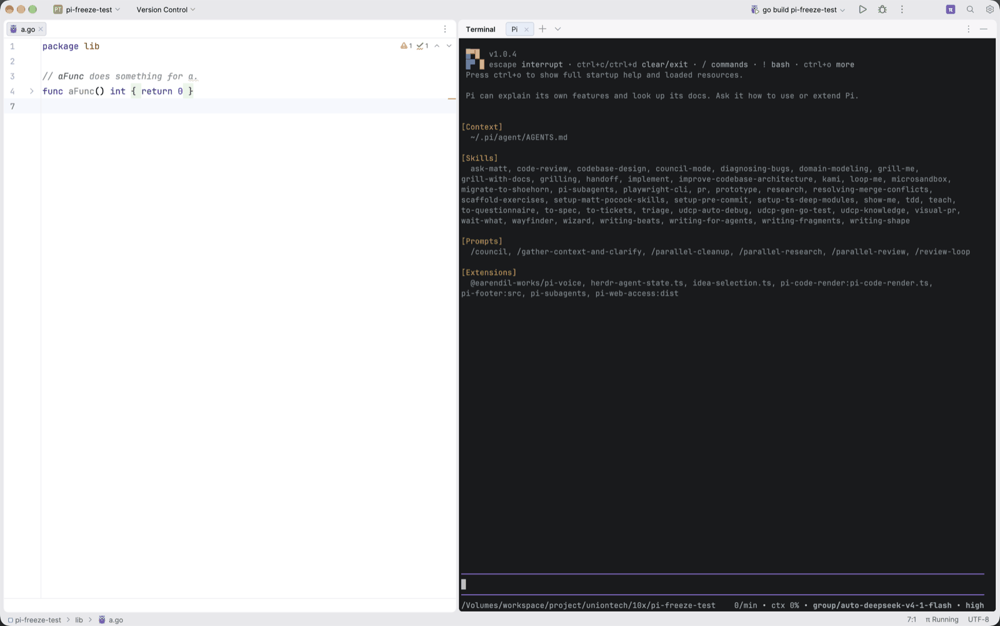
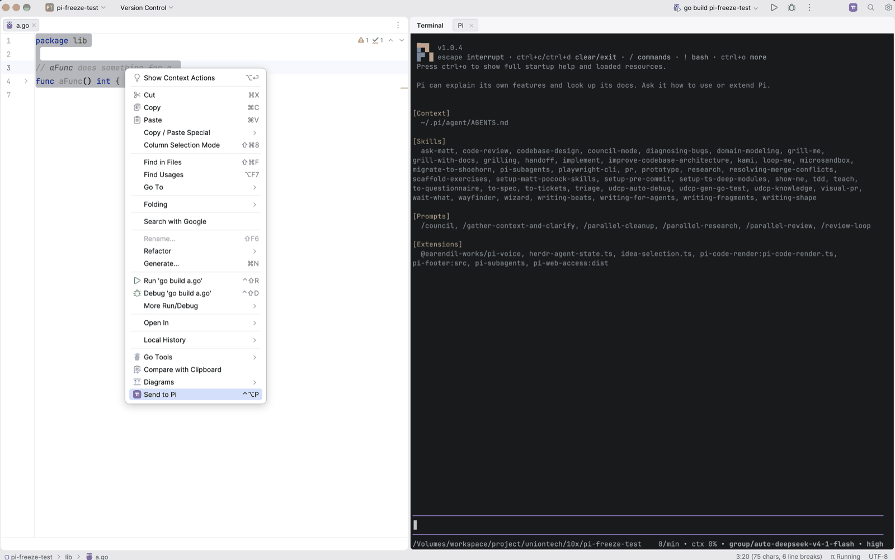
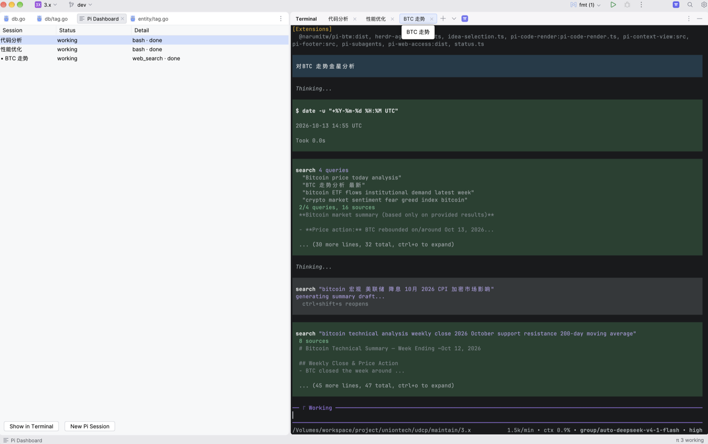
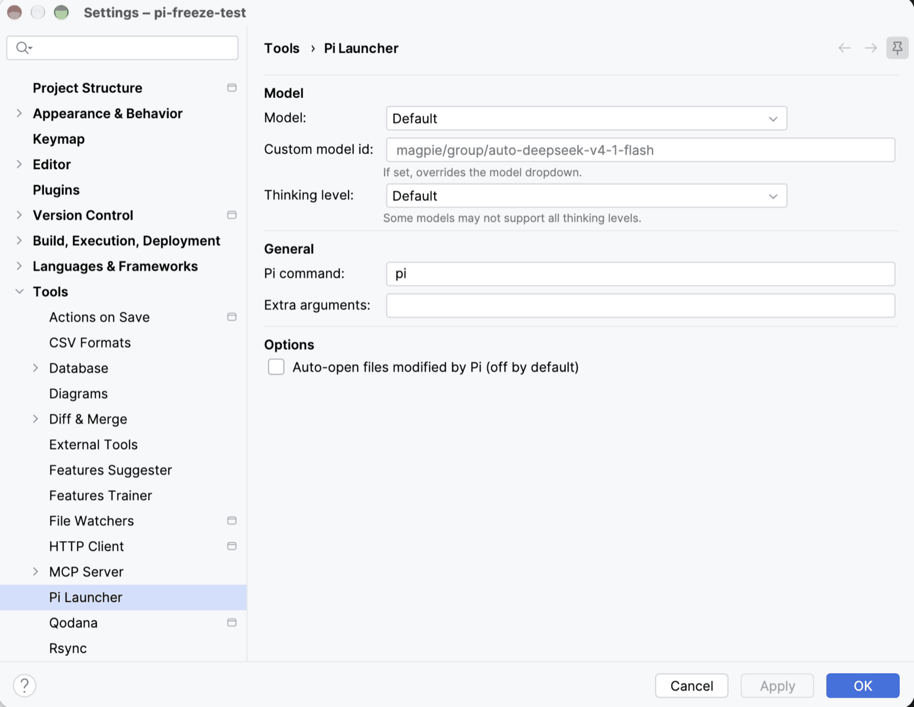

# Pi Launcher

[中文文档](README_CN.md)

One-click [Pi coding agent](https://pi.dev) launcher for JetBrains IDEs — opens "Pi 1", "Pi 2", … tabs inside the Terminal tool window and starts `pi` automatically, several sessions at a time, each with the state Pi reports for itself.

[](LICENSE)

| | |
|---|---|
|  |  |
|  |  |

## Features

- **One-click launch** — Click the π button in the toolbar to start Pi
- **Terminal integration** — each Pi session runs as its own tab in the IDE's Terminal window (alongside Local), so several sessions can run side by side
- **New Pi Session** — right-click a Terminal tab to start an additional session
- **Send to Pi** — Select code → Right-click → "Send to Pi" inserts `@path/file.go#L10-25` into the active session's input
- **Live session status** — The status bar shows what Pi is doing (`working`, `blocked`, `done`, `error`, `idle`), not how many tabs happen to be open
- **Session Dashboard** — One editor tab listing every session with its state and Pi's own words: the dialog it is blocked on, an error's first line, the tool call it is running
- **Rename a tab, rename the session** — The dashboard and the tooltip use the tab's display name, so `Pi 1` renamed to `api work` is `api work` everywhere
- **Model configuration** — Pick model and thinking level from `~/.pi/agent/models.json`

All sessions share the same settings; the command line is a snapshot taken when a session starts.

## Session status

Pi reports its own execution state, and the plugin shows it rather than guessing:

| State | What Pi announced |
|-------|-------------------|
| `working` | an agent run or a compaction is in progress |
| `blocked` | a dialog is waiting for you — the tooltip and the dashboard name it |
| `done` | a run finished |
| `error` | a run ended with an error that Pi did not retry |
| `idle` | Pi started, or you cancelled the run |

A session Pi has not reported on reads **`no status from Pi`** — never `idle`. Not
every Pi build can be reported on, and a plugin that cannot see a state should say
so instead of inventing one.

The status arrives through a small extension the plugin loads into Pi
(`--extension`, see `docs/adr/0005`), because Pi's own status protocol is an OSC
escape sequence that the IDE terminal discards (`docs/adr/0004`). The plugin asks Pi
whether it accepts the flag before using it, so an older Pi keeps working and simply
reports no status.

Click the status bar entry to open the **Session Dashboard**; **Alt+click** starts a
new session without leaving what is on screen. The dashboard is read-only apart from
two safe actions: show a session in the Terminal window, or start another one.

## Silent by design

Pi sessions routinely rewrite dozens of files. The plugin deliberately opens **no**
diff editor, shows **no** per-file notification and reports **no** exit — surfacing
100 modified files as 100 editor tabs is unusable. Review the work with `git diff`.

The only notification it ever raises is an error when *you* click launch and the
terminal cannot be created.

If you do want modified files opened as ordinary editor tabs, opt in via
**Settings → Tools → Pi Launcher → Auto-open files** (off by default).

## Keyboard Shortcuts

| Shortcut | Action |
|----------|--------|
| `Ctrl+Shift+Backquote` | Focus the active Pi session, or launch one when none is running |
| `Ctrl+Shift+L` | Send selection to the active Pi session |
| — | New Pi Session (no default shortcut; use the Terminal tab context menu or Search Everywhere) |

## Quick Start

1. Install the plugin
2. Ensure the `pi` CLI is installed and in your PATH:
   ```bash
   npm i -g @earendil-works/pi-coding-agent
   ```
3. Click the **π** button in the toolbar
4. A "Pi 1" tab opens in the Terminal window and `pi` starts automatically
5. For another session: right-click the Terminal tab → **New Pi Session**

## Configuration

**Settings → Tools → Pi Launcher**

- **Model** — Select from models defined in `~/.pi/agent/models.json`
- **Custom model id** — Override the dropdown with any model identifier
- **Thinking level** — Default / none / low / medium / high / max
- **Pi command** — Custom path to pi binary
- **Extra arguments** — Additional CLI flags
- **Auto-open files** — Off by default. When enabled, opens modified files as ordinary editor tabs (never diffs), debounced and capped.

## Supported IDEs

Works with all JetBrains IDEs: IntelliJ IDEA, GoLand, PyCharm, WebStorm, PhpStorm, CLion, Rider, RubyMine, and more.

## Why the code is shaped like this

Five constraints drive the design:

1. **VFS change notifications arrive on a background thread.** Feeding them
   straight into editor APIs is what used to freeze GoLand: a burst of writes
   meant a burst of editor work, off the EDT, racing the platform's read/write
   lock. All editor access now goes through `PiChangeDebouncer`, which coalesces
   a burst, filters irrelevant changes, skips indexing, and dispatches to the EDT.

2. **Process liveness cannot be probed naively.** For pty4j local terminals,
   `TtyConnector.isConnected()` is delegated to a short-lived spawn helper rather
   than the interactive shell, and `ShellTerminalWidget.hasRunningCommands()`
   returns early with `false` whenever that is false. `pid()` is the real child
   pid, so the shell's process tree is inspected instead — unwrapping the RD
   connector proxy the block terminal installs first.

3. **The terminal API differs per engine.** Tabs are opened with the
   engine-agnostic `createShellWidget` (not `createLocalShellWidget`, which casts
   to a JediTerm widget and throws on the block engine), through reflection with
   `setAccessible`, because the classic engine returns a package-private bridge
   class. See `docs/adr/0002`.

4. **A fresh tab has no pty, and two sends are not ordered by anything.** The
   launch command waits out a settle delay and retries while the pty is missing,
   so a prompt reference sent in parallel could be typed first and run by the
   shell as part of the command line (`zsh: no such file or directory: @path…`).
   Input is queued behind the delivery of the launch command. See `docs/adr/0003`.

5. **Pi cannot be observed from outside.** Its own status protocol is an OSC escape
   sequence the IDE terminal discards, it offers no attach, and it writes no status
   file. The plugin therefore loads a small extension into Pi with `--extension` and
   reads the file that extension writes (`docs/adr/0005`) — after asking Pi whether it
   accepts the flag, because a flag an older Pi rejects would stop the session from
   starting at all.

## Development

```bash
# Build
./gradlew build

# Run unit tests
./gradlew test

# Run sandbox IDE for testing
./gradlew runIde

# Package
./gradlew buildPlugin
```

## Project Structure

```
src/main/kotlin/com/chengyayu/pilauncher/
├── domain/                        # Pure logic, no IDE types, unit tested
│   ├── PiLaunchOptions.kt         # Inputs that determine how Pi starts
│   ├── PiCommandLine.kt           # Renders options into the CLI command
│   ├── PiFileReference.kt         # @path#L10-25 references
│   ├── PiStatus.kt                # Session Status: a state, a message, an activity
│   ├── PiStatusReport.kt          # Decodes what the Pi-side extension writes
│   ├── PiStatusReadout.kt         # Wording shared by the status bar and dashboard
│   └── PiModel.kt                 # Model advertised by the Pi CLI
├── infrastructure/                # Adapters to the IDE and the filesystem
│   ├── PiTerminal.kt              # Terminal interfaces (fakeable)
│   ├── IdeTerminalProvider.kt     # Reflective Terminal tool window access
│   ├── PiStatusChannel.kt         # Per-session status source (fakeable)
│   ├── PiStatusExtension.kt       # Hosts the Pi-side extension, reads its reports
│   ├── PiModelRepository.kt       # Reads ~/.pi/agent/models.json
│   └── PiNotifier.kt              # Notification interface + IDE impl
├── util/
│   └── PiChangeDebouncer.kt       # Coalesces write bursts, IDE-free
├── services/
│   ├── PiSessionService.kt        # Project-facing adapter
│   ├── PiSessionRegistry.kt       # All running sessions + Active Session pointer
│   ├── PiSession.kt               # One session's lifecycle
│   ├── PiSessionListener.kt       # Observable running-session count (topic)
│   ├── PiSessionStatusListener.kt # Observable session snapshot (topic)
│   ├── PiCommandDispatcher.kt     # Sends the start command
│   ├── PiFileWatcher.kt           # Optional auto-open (off by default)
│   ├── PiStatusWidget.kt          # Status bar entry
│   └── PiVfsUtils.kt              # VFS change filtering
├── ui/                            # The Session Dashboard editor tab
│   ├── PiDashboardPanel.kt        # Table of sessions + safe actions
│   ├── PiDashboardTableModel.kt   # Readout -> row mapping
│   └── PiDashboardEditorProvider.kt  # One dashboard tab per project
├── actions/                       # Extract input, delegate to a service
└── settings/                      # Persisted state and settings UI

src/main/resources/pi/
└── pi-launcher-status.ts          # The reporter loaded into Pi with --extension
```

The `domain` and `util` packages have no IntelliJ dependencies, so argument
handling, reference formatting, status decoding and debouncing are covered by plain
unit tests (`./gradlew test`).

## License

MIT
