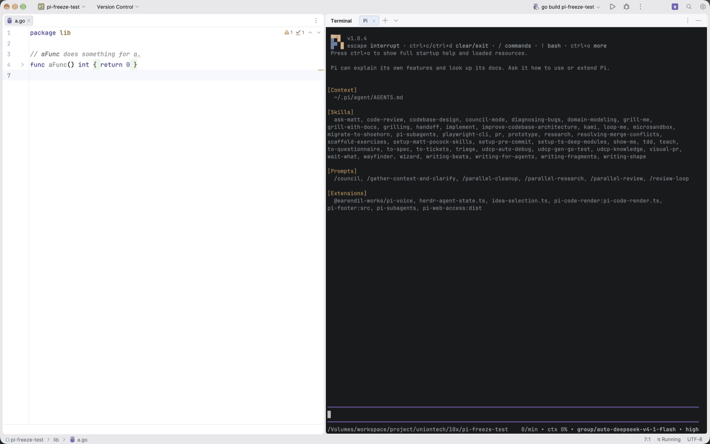
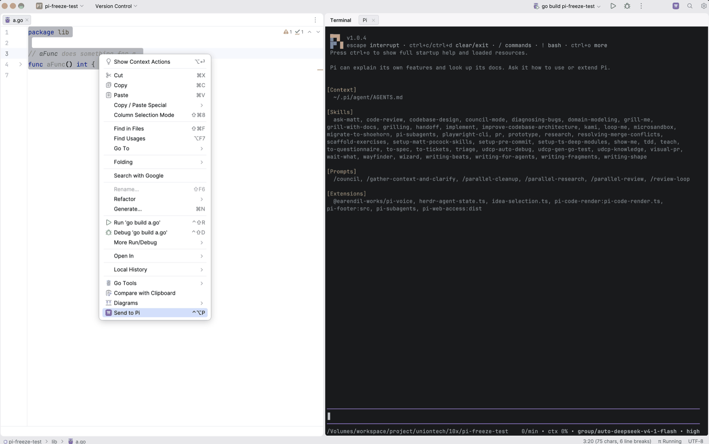
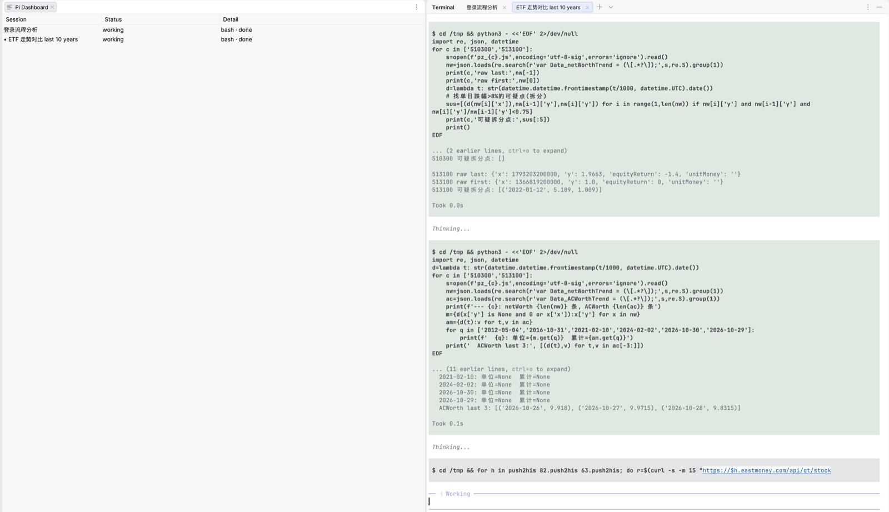
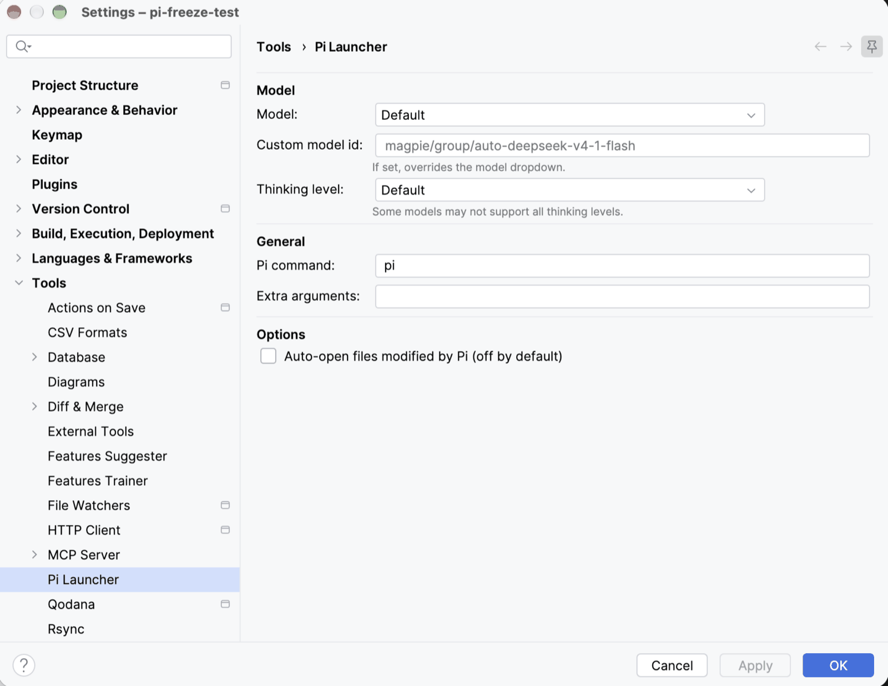

# Pi Launcher

[English](README.md)

一键启动 [Pi coding agent](https://pi.dev) 的 JetBrains IDE 插件 —— 在 Terminal 窗口中打开 "Pi 1"、"Pi 2"… tab 并自动启动 `pi`，可以同时跑多个会话，每个会话都显示 pi 自己报告的执行状态。

[](LICENSE)

| | |
|---|---|
|  |  |
|  |  |

## 功能

- **一键启动** — 点击工具栏 π 按钮启动 Pi
- **终端集成** — Pi 作为 IDE Terminal 窗口的一个 tab（和 Local 并列），每个会话一个 tab，可同时运行多个 Pi Session
- **再开一个会话** — **Alt+点 π**：普通点只是聚焦当前会话
- **发送选区** — 选中代码 → 右键 → "Send to Pi"，自动插入 `@path/file.go#L10-25` 到当前会话（Active Session）输入框；在项目树里右键**文件或文件夹**，发送它的 `@path`
- **拖文件给 Pi** — 把截图或任意文件拖到 Pi tab 上，路径以 `@path` 插入输入框（不提交），不会再新建一个 Local tab
- **真实状态** — 状态栏显示 pi 在做什么（`working` / `blocked` / `done` / `error` / `idle`），而不是开了几个 tab
- **Session Dashboard** — 一个编辑器 tab 列出运行中的会话及其状态，以及 pi 自己说的话：卡在哪个对话框、错误首行、正在跑的工具调用
- **重命名 tab 就等于重命名会话** — 面板与 tooltip 都用 tab 的显示名，`Pi 1` 改成 `api work` 后到处都叫 `api work`
- **模型配置** — 从 `~/.pi/agent/models.json` 里选模型，并选 thinking level，或直接填写任意模型 id

所有会话共用同一套设置，命令在会话启动时取快照。

## 会话状态

状态是 **pi 自己报告的**，不是插件猜的：

| 状态 | pi 报告的含义 |
|------|--------------|
| `working` | agent run 或 compaction 进行中 |
| `blocked` | 有对话框在等你 —— tooltip 与面板会写出它的标题 |
| `done` | 一次 run 结束 |
| `error` | 一次 run 因错误结束且 pi 未重试 |
| `idle` | pi 刚启动，或你取消了这次 run |

**没有报告的会话显示 `no status from Pi`，绝不会显示 `idle`。** 不是每个 pi 版本都能被报告，而插件看不到状态时应该说看不到，而不是编一个——状态栏把这种会话计为 `N unknown`，不会把它算进某个状态。**tab 关掉、或 `pi` 进程退出的会话直接消失**：没有东西在跑，就没有状态可显示。

状态的来源是插件加载进 pi 进程的一个小扩展（`--extension`，见 `docs/adr/0005`）——因为 pi 自带的状态协议是 IDE 终端会丢弃的 OSC 转义序列（见 `docs/adr/0004`）。插件会先问 pi 是否接受该 flag，老版本 pi 照常工作，只是没有状态。

点击状态栏打开 **Session Dashboard**；**Alt+点击** 直接新开一个会话。一个 Pi Session 的寿命就是这次运行的寿命：关掉它的 tab、或 `pi` 进程退出，它就从面板和状态栏里消失。对话本身还在 pi 那边，只是插件不再提供重开的入口（`docs/adr/0009`）。

面板只做这些、以及不会打扰运行中会话的事：切到 Terminal tab，或者再开一个。改 tab 名会同步到所有显示会话名的地方。

## 默认安静

Pi 一次 session 经常改写几十个文件。插件**不弹 diff**、**不弹逐文件通知**、**不上报退出**——把 100 个改动文件变成 100 个标签页是无法使用的。想看改动请用 `git diff`。

唯一会弹的通知：**你点启动但终端创建失败**时的错误提示。

如果你确实希望把改动文件开成普通编辑器标签，可在
**Settings → Tools → Pi Launcher → Auto-open files** 手动开启（默认关闭）。

## 快捷键

| 快捷键 | 功能 |
|--------|------|
| `Ctrl+Shift+Backquote` | 聚焦当前会话，没有会话时启动一个 |
| `Ctrl+Shift+L` | 发送选区到当前会话 |
| `Alt` + 点 π | 另开一个会话（普通点击是聚焦当前会话） |

## 快速开始

1. 安装插件
2. 确保 `pi` CLI 已安装且在 PATH 中：
   ```bash
   npm i -g @earendil-works/pi-coding-agent
   ```
3. 点击工具栏 **π** 按钮
4. Terminal 窗口中打开 "Pi 1" tab，自动启动 `pi`
5. 想再开一个会话：**Alt+点 π**（或用 Dashboard 里的 **New Pi Session**）

## 配置

**Settings → Tools → Pi Launcher**

- **Model** — 从 `~/.pi/agent/models.json` 中选择模型
- **Custom model id** — 自定义模型标识符
- **Thinking level** — Default / none / low / medium / high / max
- **Pi command** — pi 二进制路径
- **Extra arguments** — 额外 CLI 参数
- **Auto-open files** — 默认关闭。开启后把改动文件开成普通编辑器标签（不会是 diff），带防抖与数量上限

## 支持的 IDE

支持所有 JetBrains IDE：IntelliJ IDEA、GoLand、PyCharm、WebStorm、PhpStorm、CLion、Rider、RubyMine 等。

## 为什么代码是这样组织的

设计由五条硬约束驱动：

1. **VFS 变更通知在后台线程到达。** 直接灌给编辑器 API 就是当年 GoLand 卡死的原因：一串写入 = 一串编辑器操作，不在 EDT 上，还和平台的读写锁赛跑。现在 `PiVfsFilter` 先丢掉不属于 Pi 的变更，`PiChangeDebouncer` 在 EDT 之外合并突发，编辑器操作只在派发时发生——索引期间是延后重试，不是丢弃。

2. **进程存活无法用常见 API 探测。** pty4j 本地终端的 `TtyConnector.isConnected()` 委托给短命的 spawn 辅助进程而非交互式 shell，引擎自己的答案不可用。`pid()` 才是真实子进程 pid，因此改为通过 `ProcessHandle` 读 shell 的进程树——先拆掉 block 终端装的 RD connector 代理，并用 `null` 表示“引擎说不清”，而不是“已退出”。

3. **两种终端引擎的 API 不一样。** 开 tab 用引擎无关的 `createShellWidget`（而不是 `createLocalShellWidget`：它会强转成 JediTerm widget，在 block 引擎上直接抛异常），并通过反射 + `setAccessible` 调用——因为经典引擎返回的是包私有桥接类。见 `docs/adr/0002`。

4. **新开的 tab 没有 pty，而“控件收下了命令”不等于“shell 执行了它”。** launch 命令要先等 settle 延迟、缺 pty 时还要重试，并行的 prompt 引用就可能先被敲进去，被 shell 当成命令行的一部分执行（`zsh: no such file or directory: @path…`）。现在输入会等存活探测看到 Pi 正在运行再放行，最多轮询 2 秒；引擎答不上来时也会放行。见 `docs/adr/0003`。

5. **pi 无法从外部观察。** 它自带的状态协议是 IDE 终端会丢弃的 OSC 转义序列，不提供 attach，也不写状态文件。因此插件通过 `--extension` 把一个很小的扩展加载进 pi 进程，读它写出的文件（见 `docs/adr/0005`）——并且会先问 pi 是否接受这个 flag：老版本 pi 拒绝它会让会话根本起不来。

## 开发

```bash
# 构建
./gradlew build

# 单元测试
./gradlew test

# 沙箱 IDE 测试
./gradlew runIde

# 打包
./gradlew buildPlugin
```

## 项目结构

```
src/main/kotlin/com/chengyayu/pilauncher/
├── domain/                                # 纯逻辑，无 IDE 类型，可单测
│   ├── PiLaunchOptions.kt                 # 决定 Pi 如何启动的输入
│   ├── PiCommandLine.kt                   # 把输入渲染成 CLI 命令
│   ├── PiFileReference.kt                 # @path#L10-25 引用
│   ├── PiStatus.kt                        # Session Status：状态 + 说明 + 当前活动
│   ├── PiStatusReport.kt                  # 解码 Pi 侧扩展写出的内容
│   ├── PiSessionReport.kt                 # 读一次该文件：状态与身份
│   ├── PiSessionId.kt                     # Pi 报告的 id 能否进入命令行
│   ├── PiStatusReadout.kt                 # 状态栏与面板共用的文案
│   └── PiModel.kt                         # Pi CLI 提供的模型
├── infrastructure/                        # 对 IDE 与文件系统的适配
│   ├── PiTerminal.kt                      # Terminal / Session Host 接口（可伪造）
│   ├── ToolWindowSessionHost.kt           # 反射访问 Terminal 工具窗口
│   ├── ReflectiveTerminal.kt              # 一个终端控件，经反射到达
│   ├── Reflection.kt                      # 终端 API 的反射辅助
│   ├── PiStatusChannel.kt                 # 单会话状态源（可伪造）
│   ├── PiStatusExtension.kt               # 托管 Pi 侧扩展并读回报告
│   ├── PiStatusProbeCache.kt              # “这个 Pi 能加载扩展吗”，只问一次
│   ├── PiModelRepository.kt               # 读 ~/.pi/agent/models.json
│   ├── PiProjectKey.kt                    # 状态临时目录的按项目命名
│   ├── DroppedFiles.kt                    # 读出拖拽携带的路径
│   ├── PiVfsFilter.kt                     # VFS 变更过滤
│   ├── PiEditorOpener.kt                  # 把文件开成普通编辑器标签
│   └── PiNotifier.kt                      # 通知接口 + IDE 实现
├── util/                                  # 小工具：合并突发、调度延时任务
│   ├── PiChangeDebouncer.kt               # 合并写入突发，无 IDE 依赖
│   └── PiScheduler.kt                     # 延时任务藏在一个接口后面（可伪造）
├── services/                              # 生命周期：单会话、全部会话、Active Session
│   ├── PiSessionService.kt                # 面向 project 的适配层
│   ├── PiSessionRegistry.kt               # 运行中的会话 + Active Session
│   ├── PiSession.kt                       # 一个会话的生命周期
│   ├── PiSessionListener.kt               # 可观察的运行会话数（topic）
│   ├── PiSessionStatusListener.kt         # 可观察的会话快照（topic）
│   ├── PiCommandDispatcher.kt             # 投递启动命令
│   ├── PiFileWatcher.kt                   # 可选的自动打开（默认关闭）
│   ├── PiStatusWidget.kt                  # 状态栏条目
│   ├── PiStatusWidgetFactory.kt           # 向平台注册该条目
│   └── ApplicationPiStatusProbeCache.kt   # 整个 IDE 共享的探测结果
├── ui/                                    # Session Dashboard 编辑器标签
│   ├── PiDashboardPanel.kt                # 会话表格 + 安全操作
│   ├── PiDashboardTableModel.kt           # Readout -> 行的映射
│   └── PiDashboardEditorProvider.kt       # 每个 project 一个 dashboard 标签
├── actions/                               # 取出输入，交给 service
│   ├── LaunchPiAction.kt                  # π 按钮：聚焦或启动；Alt+点再开一个
│   ├── SendSelectionAction.kt             # 选区 -> @path#L10-25
│   ├── SendFileToPiAction.kt              # 文件或文件夹 -> @path
│   ├── PiPrompt.kt                        # 各“插入引用”动作共用的路径
│   └── EventFiles.kt                      # 解析动作作用在什么上
└── settings/                              # 持久化状态与设置 UI
    ├── PiSettings.kt                      # IDE 持久化的状态
    ├── PiSettingsConfigurable.kt          # Settings → Tools → Pi Launcher
    └── PiSettingsForm.kt                  # 背后的控件

src/main/resources/pi/
└── pi-launcher-status.ts                  # 用 --extension 加载进 Pi 的报告器
```

`domain`——以及 `PiChangeDebouncer`——不带 IntelliJ 类型，所以参数处理、引用格式化、
状态解码与防抖都有不依赖 IDE 的单元测试覆盖（`./gradlew test`）。

## 许可证

MIT
